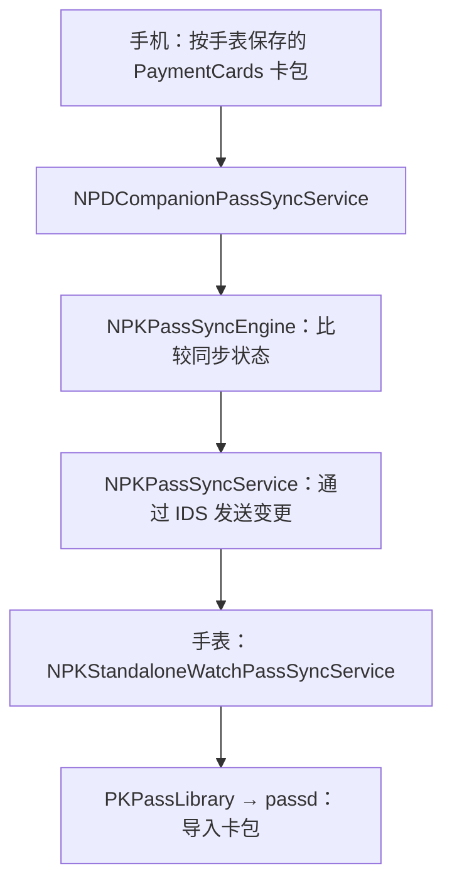

# 手表卡面更新入口：系统分析与模拟器实验

更新日期：2026-10-21。
结论：**已定位一条包含支付卡、从手机文件到手表钱包导入的系统调用链；
尚未证明 AirCard 能在目标实机上触发它。**

## 分析材料与适用范围

2026-10-20 使用本机安装的 Apple 模拟器运行时，工具为 `xcrun dyld_info -objc`、
`xcrun dyld_info -disassemble` 和 `xcrun dwarfdump --uuid`。
当日只做静态分析。2026-10-21 的内存状态实验见文末；两轮均未导入卡片。

| 运行时 | 二进制 | Mach-O UUID |
| --- | --- | --- |
| iOS 26.5 / `23F77` | NanoPassKit.framework/NanoPassKit | `695846CD-763E-368E-9AA3-E24598B45761` |
| iOS 26.5 / `23F77` | NanoPassKit.framework/NPKCompanionAgent | `412F86D5-4024-3EF2-956B-041D018DC30E` |
| watchOS 26.5 / `23T570` | NanoPassKit.framework/nanopassd | `43740E0C-3FF6-36B2-805D-7D52D6310674` |
| watchOS 26.5 / `23T570` | PassKitCore.framework/passd | `CA58AFD7-3095-3566-ADFC-97BE0066ABE5` |
| watchOS 26.5 / `23T570` | PassKitCore.framework/PassKitCore | `88058C0D-734C-3A03-9220-AC6715830935` |

UUID 标识的是系统二进制，不是用户设备。没有把系统二进制、完整反汇编、
设备标识或卡包提交到仓库。
这些版本与目标 **iOS 27.0.1 / watchOS 26.6** 不同。
下文先记录静态调用链，文末单独记录实际执行过的模拟器状态实验。

2026-10-21 后续已读取目标 **iOS 27.0.1 / `24A446`** 的系统共享缓存并提取三个框架。
当前构建确认了相同的 `localPairingDataStorePath → NanoPasses → PaymentCards` 构造，
以及 `archiveData → savePaymentPassData:withUniqueID:forPairingID:completion:` 客户端调用。
具体地址与软件 UUID 见[当前版本核对记录](WATCH-RESEARCH.md#当前-ios-2701-的静态核对结果)。
这项核对不包括当前实机的服务端权限、手表端导入或真实卡包同步。

## 支付卡资料的来源

`NPKHomeDirectoryPathForDevice` 读取设备的
`NRDevicePropertyLocalPairingDataStorePath`，追加 `NanoPasses`；
`NPKPaymentPassDirectoryPathForDevice` 再追加 `PaymentCards`。

由此确认的**路径构造规则**是：

```text
<该手表的 LocalPairingDataStorePath>/NanoPasses/PaymentCards/
```

`NPDCompanionPaymentPassDatabase` 在这里读写按唯一标识命名的卡包。
基础目录的实机值、武汉卡在手表上的唯一标识和资源文件名尚未取得。
不能把这一模板展开为猜测的 `/var/mobile/...` 路径后直接写入。
`NPKHomeDirectoryPathForDevice` 还有 `/Library/NanoPasses/` 后备分支，
不能用它替代已配对设备的实际目录。

这批资料**参与向 Watch 发送的同步**，并非只用于手机预览：

1. `NPDCompanionPassSyncService.currentLibraryPassSyncStateWithReconciledState:`
   枚举 `companionPaymentPassDatabase.uniqueIDs`，读取 `paymentPassWithUniqueID:`，
   并将支付卡加入同步状态。
2. `_passWithUniqueID:` 优先读取同一支付卡数据库，再查询普通票券来源。
3. `passSyncEngine:dataForPassWithUniqueID:` 对取得的卡片调用 `archiveData`。
4. `passSyncEngine:partialDataForPassWithUniqueID:baseManifest:outRemoteAssets:`
   还支持按资源清单制作增量包。

## 现行同步链



关键落点及条件：

| 位置 | 已观察到的行为 |
| --- | --- |
| 手机 `NPKCompanionAgent._createSyncServiceIfNecessary` | 在 standalone 分支创建 `NPDCompanionPassSyncService`，执行 `start` 与 `handlePassLibraryChanged` |
| 手机 `NPDCompanionPassSyncService._companionPaymentPassDatabaseChanged:` | 调用 `handlePassLibraryChanged` |
| 框架 `NPKPassSyncService._provideUpdatedLibraryStateToSyncEngineAndSyncIfNecessary:` | 更新库状态、判断是否有实质差异，再决定同步 |
| 框架 `NPKPassSyncService.passSyncEngine:sendStateChange:` | 包含 `passData`，经 `NPKProtoSendWithOptions` 发送，支持大卡包分段 |
| 手表 `NPKStandaloneWatchPassSyncService._savePassData:forSyncStateItem:baseManifestHashForPartialUpdate:remoteAssetsForPartialUpdate:completion:` | 完整卡包写到临时 URL，交给 `addUnsignedPassesAtURLs:withCompletionHandler:` |
| 同一手表方法的增量分支 | 检查基础 manifest 哈希，构建更新后的卡片，调用 `addPasses:withCompletionHandler:` |
| 手表 `PDPassLibrary.usingSynchronousProxy:addUnsignedPassesWithDataFileDescriptors:completionHandler:` | 先检查调用者权限，再使用 `validationOptions = 2` 解析卡包，继续进入 `_addPasses:withCompletion:` |

因此这里存在系统内部的真实导入入口。
但**代码中有这条链、服务收到请求、导入成功、指定卡面显示成功是不同的验证层级**。
已完成调用链的静态定位，以及文末的同步状态判定实验；其余层级未通过验收。

## 为什么只换图片可能无效

`NPKPassSyncStateItem.initWithPass:` 取得卡片的类型、序列号、
`sequenceCounter`、`NPKManifestHashForPass` 和 `NPKManifestForPass`。
后者读取卡包的 `manifest.json`。
`NPKManifestHashForPass` 使用已有 manifest 哈希，必要时由文件 URL 计算；
这里没有看到它因任意 PNG 内容改变而重新生成资源清单。

据此推断：**只改 PNG、保留旧清单，可能不会产生同步引擎认可的状态变化**；
增量打包还可能把清单未变化的资源排除。
下一步实验应验证图像与对应清单一起更新的行为，而不是只删手机渲染缓存。
这仍是待实机验证的方案，不是对用户此前失败原因的定论。

不能为了强制同步去修改交通卡的业务版本或支付资料。
同步引擎的 `_shouldProcessAddOrUpdateChangeOfType:...` 在本地库状态与已协调状态相同时，
有直接允许应用传入变更的分支；发生冲突时才进一步比较 `sequenceCounter` 等条件。
所以目前没有证据要求人为递增支付卡的 `sequenceCounter`。

## 权限与触发方式

### 读取手表登记也有权限边界

目标 iOS 27.0.1 上，独立开发 App 的 NanoRegistry 查询在解锁及 3 秒初始化等待后，
仍返回空设备列表；同次 Mac companion 服务返回 1 条手表登记。
当前系统的集合返回方法具有 `hasEntitlements` 守卫，探针没有相应权限。
因此不能把“开发 App 能加载私有框架”当成“能读取真实目录”。
这条普通 App 直读路线未打通，具体证据与限制见
[解锁后的复核](WATCH-RESEARCH.md#用户解锁后的复核与权限边界)。

### 直接调用保存 API 有权限门槛

手机 `NPKCompanionAgent.listener:shouldAcceptNewConnection:` 对保存服务的 XPC 连接检查
`com.apple.NPKCompanionAgent.client`。
获准的客户端通过
`NPDCompanionAgentClient.savePaymentPassData:withUniqueID:forPairingID:completion:`
进入支付卡数据库保存流程。
方法存在不意味着普通 iPhone App 或 Mac 的 lockdown 连接有调用权限。

手表 `passd` 的 unsigned 导入路径检查 `passesAddUnsigned`，
对应 `com.apple.passes.add-unsigned`。
`validationOptions = 2` 的解析路径检查卡包结构；签名及资源摘要的完整验证位为另一位。
这项观察解释了系统为何有 unsigned 导入接口，**不授予第三方该权限，
也不保证任意修改过的支付卡都能通过后续处理**。

### 文件更新与同步触发需要分别验证

数据库保存后，`_postPaymentPassDatabaseChanged` 通过
`NSNotificationCenter.defaultCenter` 发送：

```text
com.apple.NanoPassKit.NPDCompanionPaymentPassDatabase.Changed
```

这是进程内部通知，不能用 Mac 上的通知或手机的 Darwin notification 直接替代。
本轮没有找到面向普通配对 Mac 的“重新扫描手表卡面”命令。

可继续验证的触发候选：

- **服务初始化后的扫描**：`_createSyncServiceIfNecessary` 明确调用
  `handlePassLibraryChanged`，但如何在实机上安全地让服务重新初始化仍待验证。
- **系统正常的钱包库变更事件**：`_handleCompanionPassLibraryChanged:` 的部分分支
  调用同一方法；设置变化、catalog 变化有各自分支，不能认为打开页面或切换任意设置都会触发。

目前没有执行重启、停止系统服务、添加票券或转移交通卡。

## 已排除的误判

- `_handleUpdateAndSendToGizmoForPass:syncID:completion:` 虽然名字像目标入口，
  但在 `NPKIsPairedDeviceStandalone()` 为真时跳过旧版发送路径。
  不能只追到这个函数就声称当前手表能收到图像。
- 旧版流程中的图片集生成、PDF 加载与图片裁剪，
  不能直接作为现行完整卡包同步的图片格式要求。
- `GetDeviceRegistry` 仍然只证明配对记录可读，不能证明上面的目录可读写。
- 暂未证实手机上的武汉卡卡包可以代替手表自己的卡包；
  两者包含面向不同设备的资料，不能互相覆盖。

## 2026-10-20：早期实机检查与实验条件

编译了仓库外的 `symbols_probe.m`，仅准备调用
`com.apple.dt.fetchsymbols` 的文件清单命令，不下载缓存、不挂载镜像、
不改变开发者模式。协议参考
[pymobiledevice3 的 dtfetchsymbols 实现](https://github.com/doronz88/pymobiledevice3/blob/master/pymobiledevice3/services/dtfetchsymbols.py)。

获得设备服务访问权限后，连续两次手机枚举都返回空列表。
所以探针尚未向手机发送该服务请求，不能把结果记为“当前系统不支持符号服务”。
USB 注册表查询也未提供可用记录；未把原因断定为线缆断开。

下一次有效实验必须完成：

1. 核实实时手机连接、目标系统实现，以及配对设备目录的真实值。
2. 取得**手表所属的现有卡包**的可恢复副本，确认该卡已在手表；
   不使用会移动原文件的 `read_file()` 作为只读路径探针。
3. 在副本中只替换图像及相关资源摘要，保留卡片身份、业务版本和支付资料。
4. 验证可用的更新触发动作与同步状态，再进行一次有恢复依据的单卡实验。
5. 以手表原生钱包实际显示指定图片验收。

在上述条件满足前，不把候选目录或接口接入 AirCard 的正式写入按钮。

## 2026-10-21：调用实际同步引擎验证状态判定

在独立创建的 Apple Watch Series 10 模拟器、watchOS **26.5 / `23T570`** 上运行
[sync_state_probe.m](../tools/watch-research/sync_state_probe.m)，通过 `dlopen` 加载该系统的
NanoPassKit。实验使用合成的卡片标识、资源摘要与版本数字，调用真实的
`NPKPassSyncStateItem`、`NPKPassSyncState`、`NPKPassSyncEngine`；没有重写一套同步算法来代替验证。

| 输入或条件 | 实际结果 |
| --- | --- |
| 相同的卡片状态 | 新增 0、更新 0、删除 0 |
| `sequenceCounter` 均为 7，仅资源清单及其哈希变化 | 新增 0、更新 1、删除 0 |
| 资源清单内容变化，但状态对象仍保留旧哈希 | 新增 0、更新 0、删除 0 |
| 接收方本地状态与已协调状态一致，传入同版本的新哈希 | 允许应用到卡片库与已协调状态 |
| 接收方已经有版本 8 的本地状态，传入版本 7 的更新 | 拒绝覆盖卡片库 |

结果全部符合检查条件，程序退出码为 0。
这证明该运行时的**状态比较与冲突判定**允许同业务版本的资源哈希更新，
进一步支持“不修改支付卡业务版本”的实验方向。
旧哈希的对照组仅测试状态对象的行为，不等同于在真实卡包里替换图片后的端到端测试。

程序没有创建 IDS 服务、连接实机或调用钱包导入接口，也没有使用真实卡包。
因此结果不能证明卡包能被导入、资源能被正确渲染或目标 watchOS 26.6 行为相同。
实验后已关闭并删除临时模拟器。

在 Apple Silicon Mac、Xcode、已安装的 watchOS 26.5 模拟器运行时上，从仓库根目录复现：

```sh
bash tools/watch-research/run_sync_state_probe.sh
```

脚本编译探针，创建独立临时设备集，运行检查后清理；不会使用已有模拟器或真实设备。
探针仅允许编译为模拟器程序。模拟器服务需要在允许访问 CoreSimulator 的环境下运行。

同日较早的实机连接检查：MobileDevice 枚举为空，CoreDevice 中目标 iPhone 的隧道为
`unavailable`，USB 清单未提供 iPhone。现有配对记录不能替代实时连接。
本机 MobileSync 备份目录的元数据读取被系统拒绝，未取得备份内容，未扩大访问权限。
随后用户再次确认卡片在手机；最新连接与实机查询结果见
[研究记录](WATCH-RESEARCH.md#2026-10-21手机恢复连接后的只读检查)。
